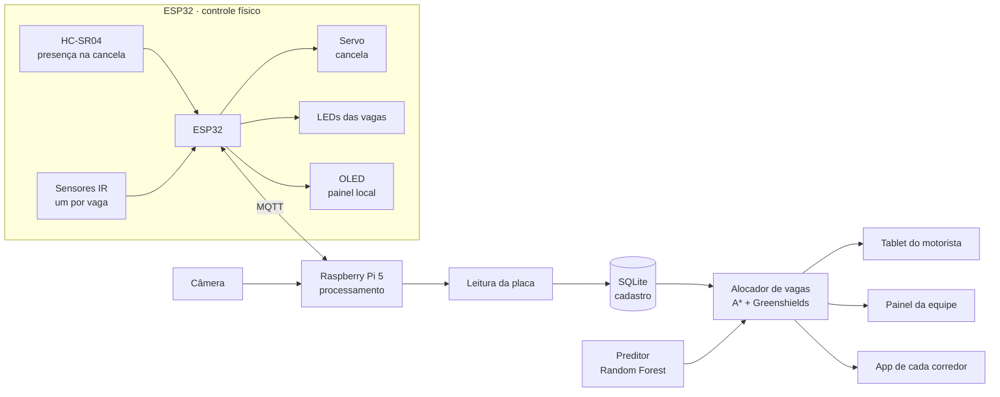
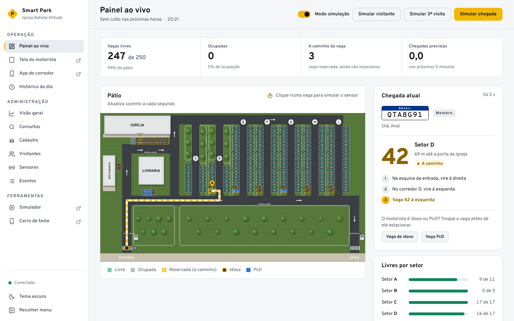

# Smart Park — orientação inteligente de vagas

TCC de Engenharia · Centro Universitário IBMR · Eduardo
Aplicação: estacionamento da Igreja Batista Atitude, que tem quatro cultos aos domingos (8h30, 11h, 17h e 19h30) e recebe quase todos os carros em poucos minutos.

Este é o projeto que desenvolvi no meu TCC. A ideia nasceu de um problema que vejo todo domingo na igreja: o estacionamento tem vaga sobrando, mas forma fila dentro dele, porque todo mundo entra no primeiro corredor e fica esperando as manobras de quem está na frente.

A minha proposta funciona assim. Quando um carro chega à cancela, uma câmera lê a placa e o Raspberry Pi descobre a categoria do motorista (membro, idoso, PcD, equipe ou visitante). Em seguida o sistema estima quantos carros ainda vão chegar nos próximos minutos e escolhe a vaga que leva todo mundo mais rápido até a porta da igreja, sem mandar todos para o mesmo corredor. O ESP32 abre a cancela, o motorista vê a vaga e o caminho num tablet, e os sensores acompanham a ocupação de cada vaga.



## A planta (250 vagas)



Desenhei o sistema em cima da planta do estacionamento da igreja (igreja, restaurante, livraria, entrada a sudoeste e saída a sudeste). Para o projeto ficar à altura de um evento grande, ampliei de 50 para **250 vagas**, com cinco corredores novos (E a I):

| Setor | Vagas | Onde |
|---|---|---|
| A | 01–11 | frente da igreja (01 PcD, 02–03 idosos) |
| B | 12–16 | restaurante e livraria (12, 13, 16 idosos; 14, 15 PcD) |
| C, D | 17–50 | corredores da planta original |
| E–I | 51–250 | ampliação: 5 corredores de 40 vagas |

Os setores **A e B, os mais próximos do templo, são exclusivos de idosos e PcD** (16 vagas), a pedido da igreja. Somando as preferenciais que deixei no fim de cada corredor da ampliação, do lado da via sul (o caminho de volta para a igreja), são 21 vagas de idosos e 5 de PcD, acima do mínimo da lei para 250 vagas (13 e 5). Cada categoria vai para a sua vaga: idoso para vaga de idoso, PcD para vaga PcD; só quando as dela acabam o sistema usa outra. Membros, visitantes e equipe nunca recebem vaga de A ou B. Entre eles, a ordem de proximidade é: visitantes (corredor C, sem penalidade), depois membros (penalidade pequena em C) e, por último, equipe e voluntários, mandados para os corredores do fundo.

A mesma planta aparece em todas as telas: no painel da equipe e no tablet do motorista, com a rota animada até a vaga; nos mapas do admin (uso de cada vaga e saúde dos sensores); e no simulador do navegador. O desenho está em `scripts/planta.js`, e a geometria, em `layout_planta()` no `smartpark/layout.py`.

Um requisito de projeto que descobri ao fazer as contas: com 250 carros chegando em uns 20 minutos, uma cancela de 6 s por carro vira gargalo (10 carros por minuto). Por isso considero que a câmera lê a placa enquanto o carro se aproxima, o que derruba o atendimento para 3,5 s (17 carros por minuto).

A maquete física que vou levar continua com 6 vagas (`--layout maquete`), uma para cada sensor do ESP32. O estacionamento de referência de 48 vagas (`--layout igreja`) é o que usei nos experimentos abaixo.

## Resultado principal (simulação, 20 cultos por cenário)

Tempo médio da chegada à cancela até a porta da igreja:

| Cenário | Sem sistema | Mais próxima | Reativa | Preditiva (IA) | Redução |
|---|---:|---:|---:|---:|---:|
| Domingo 8h30 | 89 s | 84 s | 83 s | 83 s | −6% |
| Domingo 11h | 111 s | 91 s | 89 s | 88 s | −20% |
| Domingo 17h | 101 s | 89 s | 87 s | 87 s | −14% |
| Domingo 19h30 | 117 s | 95 s | 91 s | 91 s | −23% |
| Evento especial (estresse) | 193 s | 113 s | 94 s | 94 s | −51% |

Como eu leio esses números:
- A maior parte do ganho vem de **orientar o motorista** e de **considerar o congestionamento** na escolha da vaga (estratégia reativa). Mandar todo mundo para "a vaga mais próxima" cria fila de manobras no primeiro corredor, e isso aparece com força no cenário de estresse.
- A prioridade de proximidade funciona: com o sistema, o visitante leva de 59 a 75 s da cancela até a porta, contra 91 a 216 s sem sistema; o membro, que agora estaciona um pouco mais longe, ainda ganha (de 97–213 s para 92–100 s).
- Onde a previsão de demanda tem uso mais direto é no **aviso antecipado de lotação** (seção própria mais abaixo): o sistema avisa 63% das lotações com 9,5 min de antecedência, em média.
- Na escolha da vaga, a previsão quase não muda o tempo porta a porta em relação à reativa (diferença abaixo de 1 s, sem significância estatística); o que ela reduz é o tempo parado em fila (de 4,4 s para 3,8 s no estresse). Quero reavaliar esse ponto com dados reais de chegada.
- O preditor Random Forest erra em média 1,55 carro por janela de 5 min (R² 0,62), praticamente empatado com o perfil médio histórico (1,51; R² 0,64) e bem melhor que uma previsão ingênua (2,18).
- Os volumes e horários de chegada ainda são **hipóteses minhas** (ver `docs/protocolo_coleta.md`). O código já aceita os dados reais em CSV, que pretendo coletar na guarita.

## Estrutura

```
smartpark/
├── raspberry/                  software do Raspberry Pi (Python)
│   ├── smartpark/              núcleo: layout, roteamento, alocador, preditor, lotação, saúde, LPR, banco, MQTT, controlador, relatório, admin
│   ├── simulador/              motor de tráfego, gerador de chegadas, treino, calibração, experimento, avaliação do aviso
│   ├── scripts/                ponte_guarita.py (programa principal) e as telas: painel.html (equipe), guarita.html (motorista),
│   │                           corredor.html (funcionário do corredor), historico.html, admin.html; estilo.css e ui.js (visual comum)
│   └── tests/                  44 testes automatizados (pytest)
├── firmware/
│   ├── esp32_controlador/      firmware do ESP32 (Arduino)
│   └── wokwi/                  circuito pronto para simular o ESP32 no navegador
├── web/simulador.html          simulador visual (abre em qualquer navegador)
├── resultados/                 CSV, JSON e gráficos dos experimentos
└── docs/                       pré-projeto, montagem, protocolo de coleta, termo de consentimento
```

## Como rodar

Precisa de Python 3.10 ou mais novo, no notebook ou no Raspberry Pi:

```bash
cd raspberry
pip install -r requirements.txt
python -m pytest -q                      # 44 testes
python -m simulador.treinar_preditor     # treina e avalia o preditor
python -m simulador.experimento          # experimento completo (~2 min) -> ../resultados/
python -m simulador.avaliar_aviso        # avaliação do aviso de lotação (~4 min)
```

No Mac, deixei atalhos de clique duplo na pasta principal: **Smart Park - Equipe.command**, **Smart Park - Motorista (guarita).command** e **Smart Park - Ensaio (apresentação).command**. Na primeira vez eles preparam o ambiente sozinhos. Se o Mac bloquear o atalho, rode uma vez no Terminal `xattr -dr com.apple.quarantine` e arraste a pasta do projeto para dentro dele.

### Nível 1 · Simulador visual
Basta abrir `web/simulador.html` no navegador. Dá para escolher o culto e a estratégia e ver os carros entrando na planta de 250 vagas. O botão "Comparar estratégias neste culto" roda 4 cultos sorteados ali mesmo. Se eu mudar a planta, regenero a página com `python scripts/gerar_simulador_web.py`.

### Nível 2 · As telas, sem hardware
```bash
python scripts/cadastrar.py demo                       # placas fictícias
python scripts/gerar_historico_demo.py --layout planta  # 30 dias de cultos fictícios
python scripts/ponte_guarita.py --sem-mqtt --layout planta
```
O mesmo programa serve quatro telas, cada uma para quem vai usar:

| Tela | Endereço | Quem usa | O que mostra |
|---|---|---|---|
| **Painel da equipe** | /equipe | recepção (computador) | pátio inteiro, último carro e vaga indicada, avisos de lotação, visitantes de hoje, histórico e admin |
| **Tela do motorista** | /guarita | tablet na cancela, virado para o carro | fica em espera e **só mostra a vaga quando o carro é detectado**: placa, saudação, número da vaga, as viradas e a rota na planta. Volta à espera depois de 30 s ou quando o carro estaciona |
| **App do corredor** | /corredor | celular de cada funcionário de corredor | os carros mandados para aquele corredor e os avisos de cadastro |
| **Admin** | /admin | coordenação (com senha) | relatórios, consultas, cadastro, visitantes, sensores e eventos |

No tablet e nos celulares (mesma rede Wi-Fi), troca-se `localhost:8080` pelo IP do Raspberry. No painel da equipe, com o **Modo simulação** ligado, o botão "Simular chegada" faz o papel do HC-SR04 e da câmera, e clicar numa vaga faz o papel do sensor IR. Esse modo vem ligado quando não há hardware (`--sem-mqtt`) e desligado com hardware, para ninguém mudar uma vaga sem querer.

### Visual das telas
Todas as telas usam o mesmo conjunto de cores, fontes e componentes, que concentrei em dois arquivos: `scripts/estilo.css` (cores do tema escuro e do claro, tipografia, espaçamento, botões, tabelas, alertas) e `scripts/ui.js` (menu lateral, tabelas com ordenação e paginação, avisos, confirmações). Escolhi a fonte Overpass, que vem da Highway Gothic das placas de estrada, e o amarelo da faixa de asfalto, usado só no que é importante. As fontes vão junto em `scripts/fontes/` (licença OFL), então tudo funciona sem internet na guarita. Conferi o contraste dos textos: passa de 4,5:1 (WCAG AA) nos dois temas.

### Histórico de permanência
O sistema registra **qual carro esteve em qual vaga, de que horas a que horas e por quanto tempo**.
- No painel da equipe, o item **Histórico do dia** abre a tela com filtros por dia, placa e vaga, o gráfico de ocupação ao longo do dia, a hora em que cada corredor lotou e a tabela de permanências.
- Pelo terminal:
  ```bash
  python scripts/relatorio.py                     # hoje
  python scripts/relatorio.py --placa ABC1D23     # onde esse carro parou nos últimos 30 dias
  python scripts/relatorio.py --vaga B04 --dia 2026-11-08
  python scripts/relatorio.py --dia 2026-11-08 --csv culto.csv   # abre no Excel
  ```
- Um limite que assumi de propósito: o sensor da vaga não lê placa, então a placa vem da reserva feita na guarita. Quem para em outra vaga aparece como "fora da vaga indicada", sem placa. A placa de carros cadastrados fica 30 dias; a de visitantes, só até o fim do dia. Depois disso continuam vaga, horários e tempos, sem placa.

### Visitantes
Ninguém fica preso na cancela: ela abre para todo carro. A leitura da placa serve só para saber **como** atender. Placa que não está no cadastro, ou que a câmera não conseguiu ler, é tratada como **visitante** e recebe uma vaga comum.

**Visitante idoso ou PcD.** A câmera não tem como saber que o motorista é idoso ou PcD. Por isso, enquanto mostra a vaga, o tablet pergunta ao visitante *"Precisa de vaga preferencial?"* e mostra dois botões grandes: **Idoso (60+)** e **Pessoa com deficiência**. Com um toque, o sistema devolve a vaga comum, indica na hora a melhor vaga preferencial com a nova rota e lembra que a credencial deve ficar visível no painel do carro. É uma autodeclaração, como a própria sinalização de vaga preferencial: muitas deficiências não são visíveis, e eu não quis criar constrangimento nem fila na cancela. O toque vale até 60 s depois da leitura e só antes de o carro estacionar, e fica registrado. A equipe também pode trocar a vaga pelo painel, inclusive para um membro que hoje precisa de ajuda (por exemplo, com a perna engessada).

**Visitantes do dia.** A placa do visitante fica guardada **só no dia da visita**. Se ele voltar no mesmo dia (culto da manhã e da noite), o sistema o reconhece, diz "Bem-vindo de volta!" e já indica a vaga preferencial, se for o caso. O painel da equipe mostra a lista de **Visitantes de hoje** para a recepção. Na virada do dia, a placa do visitante é apagada de todo o histórico.

**Contagem de visitas e oferta de cadastro.** Eu queria que a igreja soubesse quando um visitante está voltando sempre, sem guardar a placa dele. A solução foi guardar um **código pseudônimo**: um HMAC-SHA256 da placa, com uma chave aleatória que fica num arquivo separado do banco (`dados/chave_visitantes.bin`, LGPD art. 13, §4º). Junto com o código ficam só os dias das visitas, por 6 meses. Uma visita é um dia diferente: manhã e noite no mesmo dia contam como uma.
- Na **3ª visita**, o funcionário do corredor para onde o carro foi mandado recebe no celular o aviso **"Ofereça o cadastro"**, com a placa e a vaga, com vibração e som.
- Ele responde *Aceitou*, *Não quis* ou *Não consegui falar com ele*. Se não conseguiu falar, o aviso volta na próxima visita; quem não quis não recebe de novo.
- Quem aceitou aparece no admin, aba **Visitantes**, como *Aceitou · falta cadastrar*. O botão **Cadastrar** abre o cadastro com a placa preenchida, e a secretaria conclui com o termo assinado. Ao se cadastrar, o histórico de visitante da pessoa é apagado.

Para isso ficar transparente, proponho uma placa na entrada: *"Estacionamento com leitura de placas para indicar vagas. Placas de visitantes são apagadas no mesmo dia; guardamos só a contagem de visitas, por 6 meses."* (LGPD, art. 9º).

### App do corredor
A igreja tem um funcionário na guarita e um em cada corredor. Cada funcionário de corredor abre **/corredor** no celular e toca na letra do seu corredor; o app lembra a escolha. Ele mostra:
- **A caminho:** cada carro que a guarita mandou para aquele corredor, com placa, nome do cadastro, categoria (com uma dica de como receber a pessoa: idoso, PcD ou visitante), vaga e há quanto tempo passou pela cancela. Assim o funcionário confere se o carro é mesmo daquela vaga e ajuda a estacionar.
- **Pararam sem indicação:** vaga ocupada sem reserva, provavelmente alguém fora da vaga indicada.
- **Estacionados** e **Outros** (trocaram de vaga, não chegaram em 5 min ou já saíram).
- O aviso da **3ª visita**, com os botões de resposta.

Se o carro troca de vaga (por exemplo, um visitante que pediu vaga PcD), ele sai da lista do corredor antigo e aparece no novo, junto com o aviso de cadastro. Para testar sem câmera, uso no painel da equipe os botões **Simular visitante** e **Simular 3ª visita**, com o app do corredor aberto em outra janela.

**Peso da caminhada por categoria.** Nos testes percebi que, para economizar 3 s de carro, o sistema mandava um cadeirante para a vaga 14, a 44 m da porta, com a vaga PcD 01 (7 m) livre. Corrigi dando mais peso à caminhada de idosos e PcD (peso 1,0 em vez de 0,3, e passo de 0,8 m/s em vez de 1,2). Rodei o experimento de novo e as médias arredondadas da tabela acima não mudaram.

### Área administrativa
Fica em **/admin**. A senha de 6 dígitos aparece no terminal na primeira vez que o sistema é aberto; para trocar, `python scripts/senha_admin.py`. Guardo só o hash da senha, e o acesso bloqueia por 1 minuto depois de 5 tentativas erradas.

| Aba | O que tem |
|---|---|
| Visão geral | situação ao vivo; indicadores do período (cultos, carros por culto, tempo médio estacionado, cultos que lotaram, % que seguiu a orientação); curva média de ocupação de cada tipo de culto; mapa de uso de cada vaga; carros por culto; categorias; quando cada corredor lota; avisos de lotação; tabela de cultos |
| Consultas | permanências filtradas por período, culto, categoria, placa e vaga, com exportação em CSV |
| Cadastro | cadastrar, buscar e excluir veículos; pedidos do titular (LGPD) |
| Visitantes | histórico de visitas por visitante e cadastros aceitos para concluir |
| Sensores | saúde de cada sensor e do ESP32 |
| Eventos | registro de tudo o que aconteceu na cancela e nas vagas |

Os indicadores são de uso do espaço. Decidi não fazer ranking de pessoas por frequência ou tempo na igreja: isso fugiria da finalidade informada no termo de consentimento e trataria dado sensível (convicção religiosa).

### Aviso antecipado de lotação
A cada 30 s o sistema estima em quantos minutos o estacionamento vai lotar: usa o modelo de previsão para os próximos 5 min e, depois disso, o perfil histórico do culto corrigido pelo volume que já chegou. Quando a previsão fica abaixo de 15 min por duas leituras seguidas:
- o painel da equipe mostra a faixa "Estacionamento deve lotar em ~N min" (amarela até 15 min, vermelha até 5 min);
- o display do ESP32 alterna a mensagem com o aviso;
- a equipe de recepção recebe a mensagem no Telegram, se configurado:
  ```bash
  python scripts/ponte_guarita.py --telegram-token <TOKEN_DO_BOT> --telegram-chat <ID_DO_GRUPO>
  ```
- o aviso e a lotação real ficam registrados, e o admin mostra se cada aviso chegou a tempo.

Resultado na simulação (`python -m simulador.avaliar_aviso`, 120 cultos, 43 lotaram). Considero lotado quando acabam as vagas **comuns**, porque as preferenciais são reservadas por lei e não servem à maioria dos motoristas:

| Método | Lotações avisadas com 5+ min | Antecedência média | Alarmes falsos |
|---|---:|---:|---:|
| **IA (proposto)** | **27/43 (63%)** | **9,5 min** | **25/77 (32%)** |
| Só a média histórica | 26/43 (60%) | 7,8 min | 12/77 (16%) |
| Ritmo dos últimos 5 min | 39/43 (91%) | 14,1 min | 68/77 (88%) |

O método que propus fica no meio: avisa um pouco mais e mais cedo que a média histórica, mas com mais alarmes falsos; 21 dos 25 alarmes falsos foram em cultos com 42 ou mais carros para 44 vagas comuns, ou seja, que quase lotaram. O ritmo dos últimos minutos avisa quase tudo, mas dispara em 88% dos cultos que não lotam.

**Modo ensaio** (para a defesa, fora do horário de culto): `python scripts/ponte_guarita.py --sem-mqtt --ensaio 10` finge que um culto começa em 10 minutos. O atalho **Smart Park - Ensaio (apresentação).command** faz isso com clique duplo e abre o painel e o tablet lado a lado.

### Saúde dos sensores
Um sensor com defeito não avisa que quebrou: ele passa a mentir. Por isso a aba **Sensores** procura sinais de defeito nos dados de cada vaga:

| Diagnóstico | Regra | Gravidade |
|---|---|---|
| Ocupada há tempo demais | mais de 6 h seguidas ocupada | falha |
| Leitura oscilando | 6+ trocas livre/ocupada em 10 min | atenção |
| Nunca registra ocupação | 0 ocupações em 14 dias, com as outras vagas usadas | atenção |
| Ocupações muito curtas | 3+ ocupações de menos de 1 min | atenção |

Cada problema vem com a ação recomendada, e a aba mostra se o ESP32 está online (mensagem de vida do MQTT). Nos dados de demonstração, simulo dois sensores com defeito (vaga 03 oscilando e vaga 250 com leituras curtas); `gerar_historico_demo.py --sem-falhas` desliga isso.

### Nível 3 · ESP32 simulado no Wokwi (hardware virtual + Pi real)
1. Em https://wokwi.com, crio um projeto ESP32 e troco `sketch.ino`, `diagram.json` e `libraries.txt` pelos arquivos de `firmware/wokwi/`.
2. Rodo o Pi apontando para o mesmo broker público. No Mac, basta o clique duplo em **Smart Park - Wokwi (ESP32 simulado).command**; no terminal:
   ```bash
   python scripts/ponte_guarita.py --broker broker.hivemq.com --prefixo smartpark-ibatitude --layout maquete
   ```
3. No Wokwi, clico no HC-SR04 e diminuo a distância para menos de 15 cm: o sistema atribui uma vaga, o servo abre a cancela e o LED da vaga começa a piscar. Movendo a chave da vaga, simulo o carro estacionando.

O broker público serve só para testes; na maquete real uso o Mosquitto rodando no próprio Pi.

### Teste na internet · "carro de teste" (GitHub + Render)
Para testar o fluxo inteiro pelo celular, de qualquer lugar, publico o sistema no Render (passo a passo em `docs/deploy_render.md`). A página **/carro** me deixa fingir que sou um carro: fotografo uma placa de teste impressa (`docs/placas_teste/placas_teste.pdf`), a leitura é feita de verdade (OpenCV + Tesseract) e cada etapa do fluxograma mostra o que o sistema realmente fez: cadastro, previsão, vaga escolhida, comandos MQTT, estacionar e sair. Ela também funciona no notebook: `http://localhost:8080/carro`.

### Nível 4 · Maquete real
Está em `docs/montagem.md`: ligações, instalação do Mosquitto, tablet em modo quiosque e o checklist da defesa.

## Perguntas que espero da banca

| Pergunta | Minha resposta curta |
|---|---|
| Por que Raspberry Pi e ESP32? | O Pi faz o que exige processamento (leitura da placa, banco, IA). O ESP32 cuida do tempo real dos sensores e atuadores e continua abrindo a cancela se o Pi cair (modo degradado). |
| Por que câmera, se ela levanta questões de privacidade? | Ela permite o atendimento preferencial automático. Em troca, não guardo nenhuma imagem, o cadastro é voluntário com termo de consentimento, as placas do histórico são anonimizadas em 30 dias (visitantes, no mesmo dia) e o titular pode pedir exclusão (LGPD). |
| Por que IR na maquete e não sensor magnético? | Na maquete os carros são de brinquedo. No asfalto, o sensor certo é o magnético ou indutivo; a interface digital (livre/ocupada) é a mesma. |
| Onde entra mecânica dos fluidos? | Modelei o tráfego como um fluido compressível (modelo LWR e relação de Greenshields entre densidade e velocidade). É essa relação que o alocador usa para estimar o tempo em cada trecho. |
| E o visitante sem cadastro? | Entra normalmente, como visitante. Se for idoso ou PcD, toca no tablet (ou a equipe troca no painel) e recebe a vaga preferencial na hora. A placa dele fica só até o fim do dia; para contar visitas, guardo só um código pseudônimo e os dias, por 6 meses. Na 3ª visita, o funcionário do corredor oferece o cadastro. |
| A IA ajuda mesmo? | Com os dados sintéticos, pouco, e eu discuto isso como resultado. Na escolha da vaga, o ganho vem quase todo do congestionamento (estratégia reativa); a previsão só reduz o tempo parado em fila. No aviso de lotação, ela avisa um pouco mais e mais cedo que a média histórica, ao custo de mais alarmes falsos. O Random Forest empata com o perfil médio porque, nos dados sintéticos, quase toda a informação está no horário. Com dados reais, que têm mais variação entre domingos, isso pode mudar, e o protocolo de coleta existe para testar isso. |
